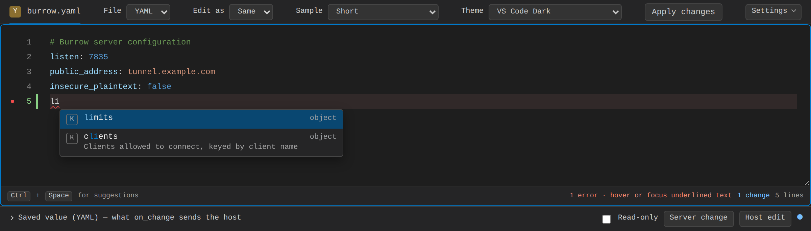
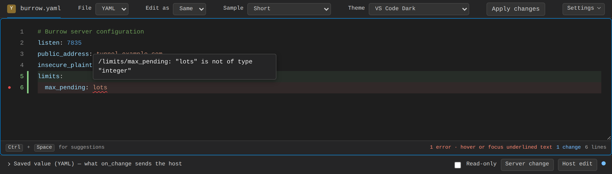
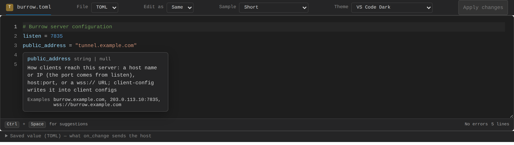
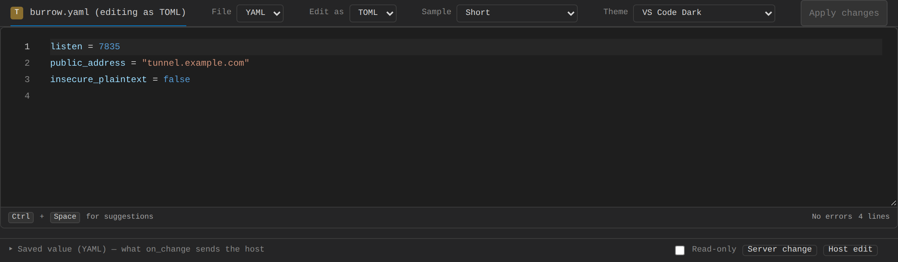
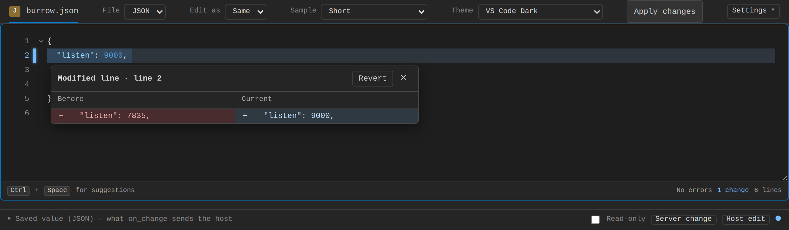
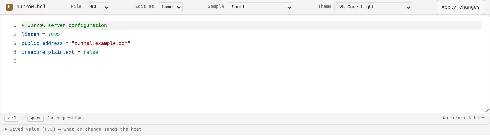

# config-editor

A lightweight, VS Code–style editor for configuration files that runs in the
browser. It edits **YAML, JSON, TOML, HCL and XML**, and one JSON Schema
drives completion, hover docs and validation in all of them. Written in Rust
and compiled to WebAssembly, with packages for Leptos, plain JavaScript and
React.



<!-- toc -->

## Contents

- [Features](#features)
- [Packages](#packages)
  - [Leptos](#leptos)
  - [JavaScript](#javascript)
  - [React](#react)
- [Repository layout](#repository-layout)
- [Development](#development)
- [Releasing](#releasing)
- [License](#license)
<!-- /toc -->

## Features

- **Schema completion:** keys and values from your JSON Schema, inserted with
  the right formatting; required child keys come with their parent, and `Tab`
  walks the empty values.
- **Validation as you type:** syntax and schema problems underlined at the
  exact key or value, with the message on hover and a count in the status bar.
- **Hover docs:** a key's description, type, default and examples.
- **Edit as another language:** open a YAML file as TOML (or any pair); edits
  are saved back in the file's own language, keeping its comments and
  untouched formatting.
- **A diff gutter:** added, modified and removed lines against a baseline,
  with a before/after preview, "Revert this change", `Alt+F5` between
  changes, a change count for the host and a unified diff for review.
- **Editing you expect from VS Code:** auto-closed brackets, quotes and XML
  tags, smart indentation, `Ctrl+/` comments, line copy/cut, find and replace
  (with regex), go to line, folding, `F8` through problems, undo/redo.
- **Schema help:** deprecated keys, documentation links and documented values.
- **Host control:** read-only fields and regions, secret placeholders that are
  never shown, problems from your server shown with the editor's own, `Ctrl+S`
  saving, an unsaved-edits flag, and a notice when the file changes on the
  server.
- **Several documents** as tabs, each with its own language and state.
- **A path API:** jump to a field and follow the caret's path for a breadcrumb.
- **Eleven themes** and per-token color overrides; a read-only mode.
- **Fast with large files:** only visible lines are rendered.
- **Your own languages,** in Rust or in JavaScript.

|                                                  |                                            |
| ------------------------------------------------ | ------------------------------------------ |
|  |   |
| Schema problems at the value, message on hover   | Docs from the schema on hover              |
|     |  |
| A YAML file edited as TOML                       | Changes against the baseline               |



More: [every feature in screenshots](docs/screenshots/README.md).

## Packages

| Package                                                  | For                                            | Install                                                           |
| -------------------------------------------------------- | ---------------------------------------------- | ----------------------------------------------------------------- |
| [`config-editor-leptos`](crates/config-editor-leptos)    | Leptos (Rust) apps, plus a headless Rust API   | `cargo add config-editor-leptos`                                  |
| [`@pngwasi/config-editor`](js/config-editor)             | Any web page or framework (vanilla JavaScript) | `npm install @pngwasi/config-editor`                              |
| [`@pngwasi/config-editor-react`](js/config-editor-react) | React                                          | `npm install @pngwasi/config-editor-react @pngwasi/config-editor` |

Each package's README documents its full API.

### Leptos

```sh
cargo add config-editor-leptos
```

```rust
use leptos::prelude::*;
use config_editor_leptos::{ConfigEditor, Language};

#[component]
fn Settings() -> impl IntoView {
    let text = RwSignal::new("listen: 7835\n".to_string());
    view! {
        <ConfigEditor
            language=Language::YAML
            value=text
            on_change=move |updated| text.set(updated)
            schema=include_str!("schema.json")
        />
    }
}
```

### JavaScript

```sh
npm install @pngwasi/config-editor
```

```ts
import init, { ConfigEditor } from "@pngwasi/config-editor";

await init();
const editor = new ConfigEditor(document.getElementById("config")!, {
  language: "yaml",
  value: "listen: 7835\n",
  schema: schemaJsonText,
  onChange: (text) => save(text),
});
```

### React

```sh
npm install @pngwasi/config-editor-react @pngwasi/config-editor
```

```tsx
import { ConfigEditor } from "@pngwasi/config-editor-react";

function Settings({ schema }: { schema: string }) {
  const [text, setText] = useState("listen: 7835\n");
  return (
    <ConfigEditor
      language="yaml"
      schema={schema}
      value={text}
      onChange={setText}
    />
  );
}
```

Vue and Svelte wrappers are planned, built on `@pngwasi/config-editor` like
the React one.

## Repository layout

```
crates/config-editor-leptos/   the editor: Leptos component and headless API (pure Rust)
js/config-editor/              wasm-bindgen bindings → @pngwasi/config-editor
js/config-editor-react/        React wrapper → @pngwasi/config-editor-react
js/examples/                   vanilla and React example pages
src/, index.html, demo.css     the demo app (trunk)
e2e/                           Playwright end-to-end tests
docs/screenshots/              a screenshot of every feature (e2e/screenshots.mjs)
```

The crate has no JavaScript in it, so a Rust project can vendor
`crates/config-editor-leptos` on its own.

## Development

How the editor is built, its design rules and the checks to run before a commit: [CONTRIBUTING.md](CONTRIBUTING.md). `make help` lists the everyday commands (`make dev`, `make check`, `make e2e`, `make fmt`, …).

Requirements: Rust 1.88+ with the `wasm32-unknown-unknown` target,
[trunk](https://trunkrs.dev), `wasm-bindgen-cli` matching the version in
`Cargo.lock`, and Node.js 20+.

```sh
# The demo, with every language, theme and Edit-as pair
trunk serve --open

# Rust tests and lints
cargo test -p config-editor-leptos
cargo clippy --all-targets
cargo clippy -p config-editor-js --target wasm32-unknown-unknown

# The npm packages and their examples (js/examples/*.html)
cd js && npm install && npm run build

# End-to-end tests (after `trunk build` and the npm build)
cd e2e && npm install && npx playwright install chromium && npx playwright test

# The screenshots in docs/screenshots, after a UI change (after the builds above)
cd e2e && npm run screenshots

# The READMEs' contents lists, after adding or renaming a section (CI checks them)
node scripts/readme-toc.mjs
```

## Releasing

Versions are kept in step: `crates/config-editor-leptos/Cargo.toml`,
`js/config-editor/package.json` and `js/config-editor-react/package.json`.
Pushing a tag `vX.Y.Z` runs [`.github/workflows/release.yml`](.github/workflows/release.yml),
which checks that the tag matches those versions, runs the tests, and
publishes the crate to crates.io and both packages to npm. It needs the
repository secrets `CARGO_REGISTRY_TOKEN` and `NPM_TOKEN`.

```sh
git tag v0.1.0 && git push origin v0.1.0
```

## License

[MIT](LICENSE)
