<!-- Written by e2e/screenshots.mjs from e2e/screenshots-gallery.mjs; edit those, not this file. -->

# Screenshots

Every feature of the editor, as it looks in the demo (`trunk serve` at the
repository root) and the JavaScript examples (`js/examples/`). They are taken
by [`e2e/screenshots.mjs`](../../e2e/screenshots.mjs) with real keys and
mouse; refresh them after a UI change with `cd e2e && npm run screenshots`.

## Writing

### Schema completion

Keys and values from the JSON Schema, with their descriptions; accepting one writes it with the right formatting.

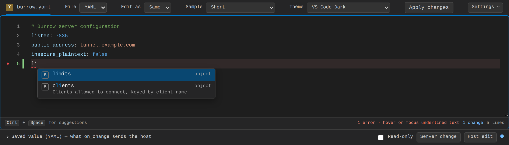

### Validation as you type

Syntax and schema problems underlined at the exact key or value; the message shows on hover and the footer counts them.

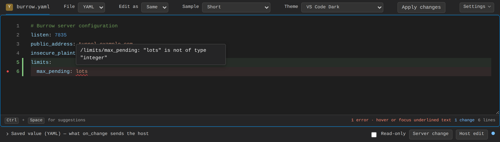

### Hover docs

A key's description, type, default and examples, from the schema.

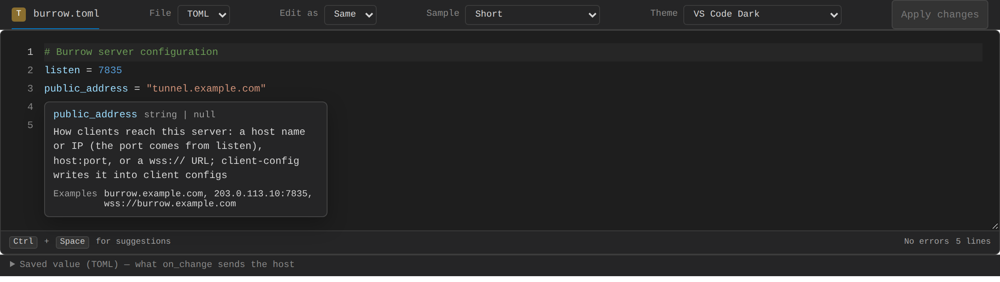

### Schema help

Deprecated keys are struck through and listed last, and a key written in the document gets a warning with what to use instead. Documented values (`x-enum-descriptions`, `oneOf` constants) show their own description, and `x-docs-url` adds a documentation link.

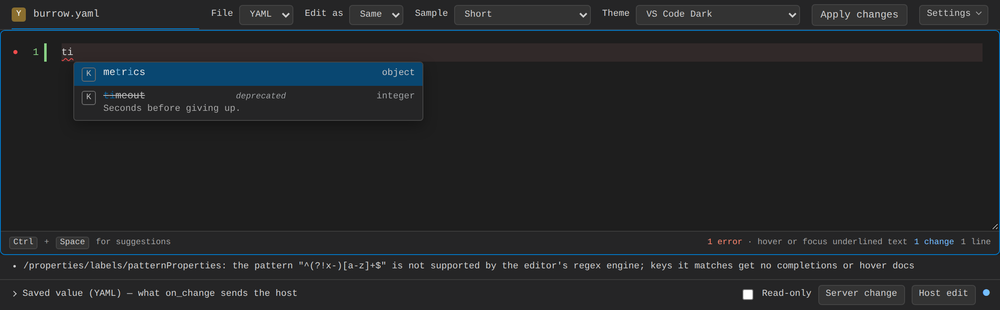

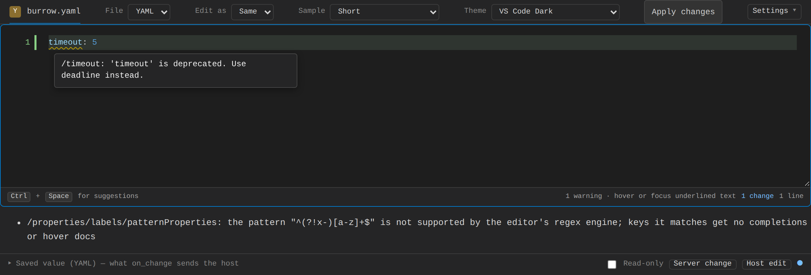

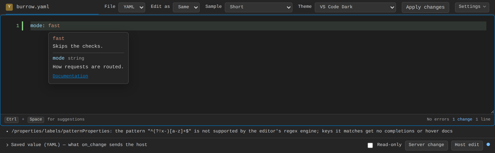

## Languages

### Edit as another language

A YAML file edited as TOML (any pair of YAML, JSON, TOML, HCL and XML); edits are saved back in the file's own language.

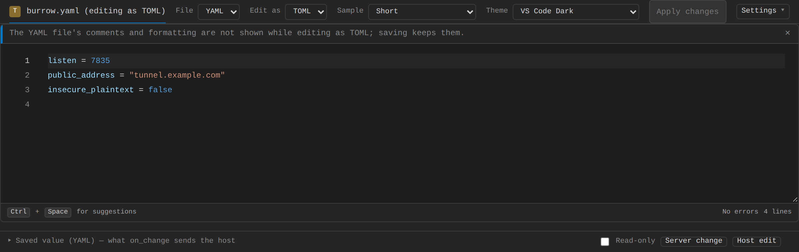

### What Edit-as keeps

A notice under the toolbar says the file's comments and formatting are not shown in the edited language (saving keeps them) and that comments typed there are not saved; it can be dismissed, and its texts come from the `strings` setting.

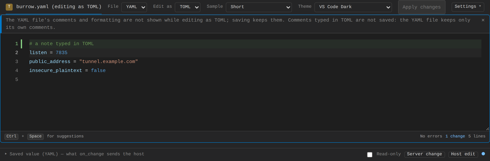

## Reviewing changes

### Changes against the baseline

Added, modified and removed lines in the gutter, each with a before/after preview and **Revert**; `Alt+F5` moves between changes, `Alt+F3` opens one with the focus on Revert, and the footer counts them.

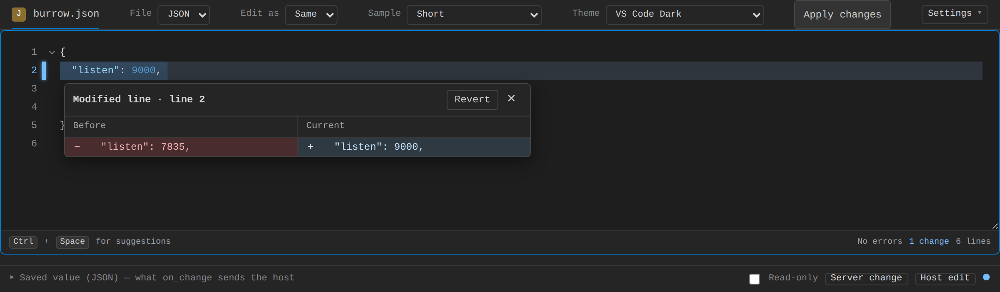

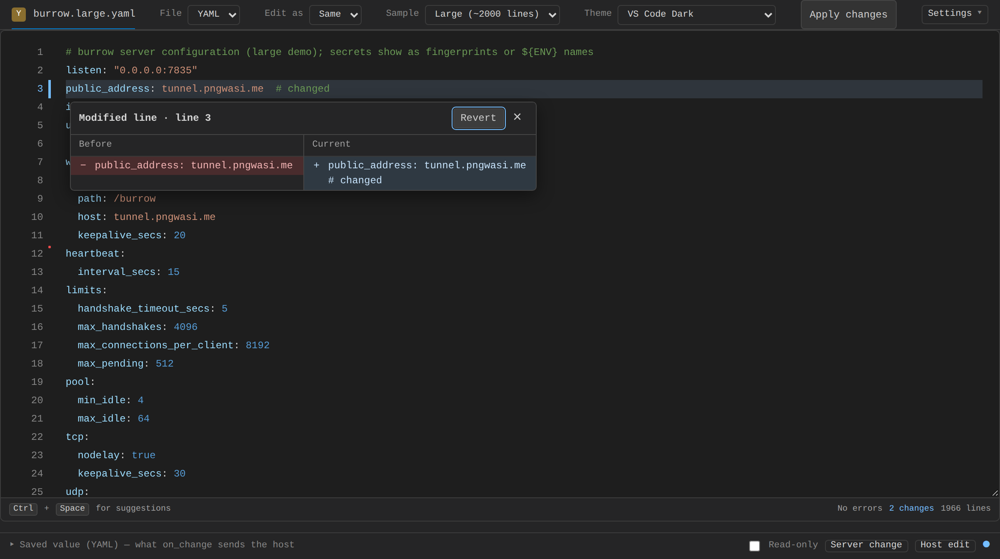

### The file changed on the server

A new baseline while there are unsaved edits asks before replacing them.

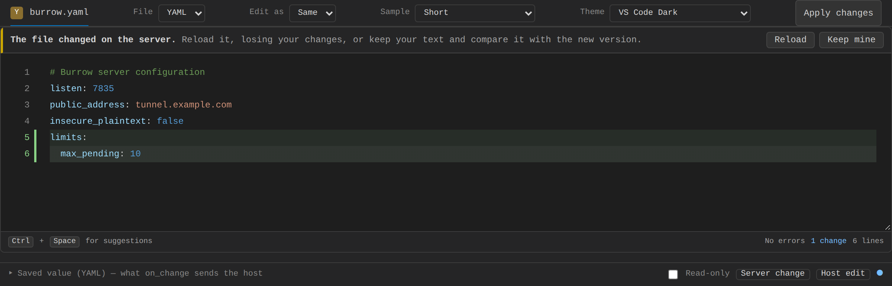

## Finding your way

### Find and replace

`Ctrl+F` / `Ctrl+H`, with match case, whole word and regex.

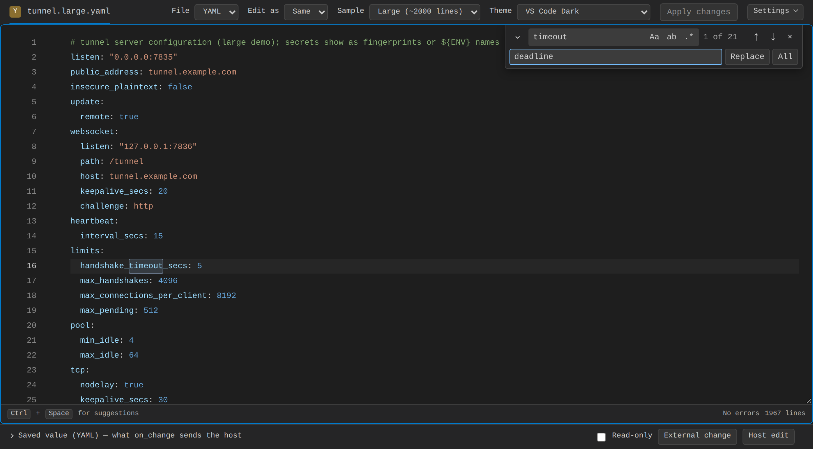

### Go to line

`Ctrl+G`, with `line` or `line:column`.

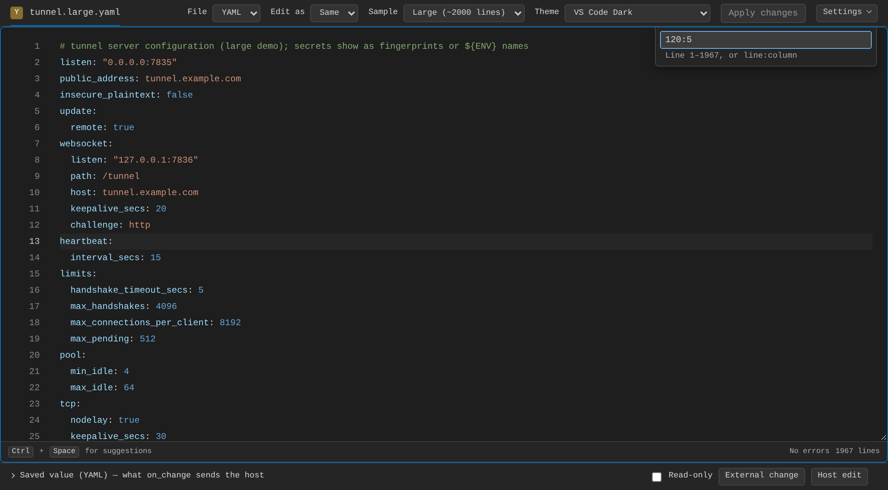

### Folding

Gutter chevrons and `Ctrl+K Ctrl+0` / `Ctrl+K Ctrl+J`; a folded block shows `…` and keeps the markers of what it hides.

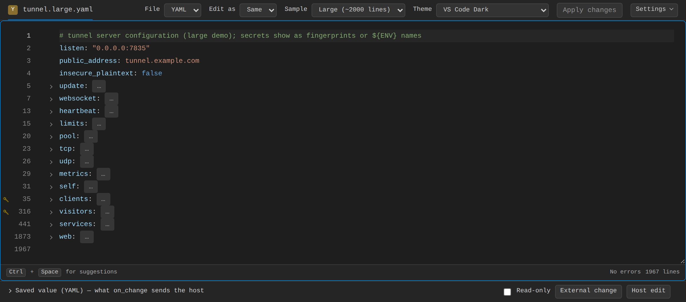

## Host control

### Read-only fields

Fields locked by the schema (`readOnly`) or the host: a lock in the gutter, the value muted, and a refused edit explains why.

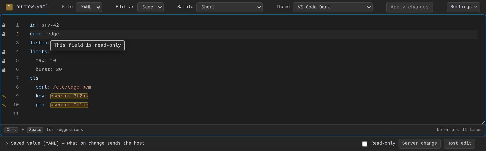

### Secrets

Placeholders the host gives (`«secret 3f2a»`) are single tokens: the caret steps over them and they are kept unless replaced.

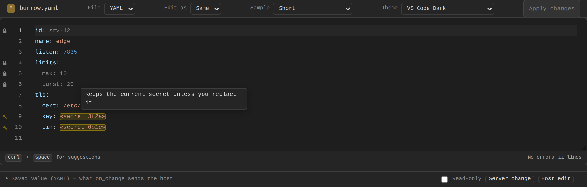

### Host diagnostics

Problems from the host (a server's validation), by path or range, with their source, code and docs link; info and hint severities too.

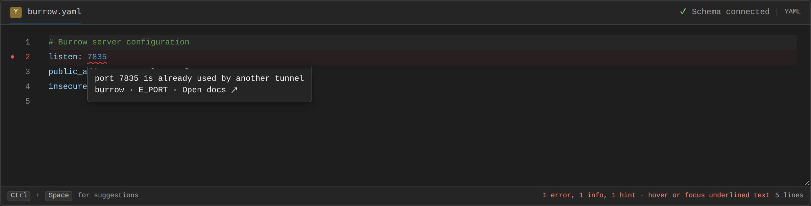

### Several documents

`ConfigDocuments`: a main file and drop-ins as tabs, each with its own language, baseline and read-only state; the dot marks unsaved edits.

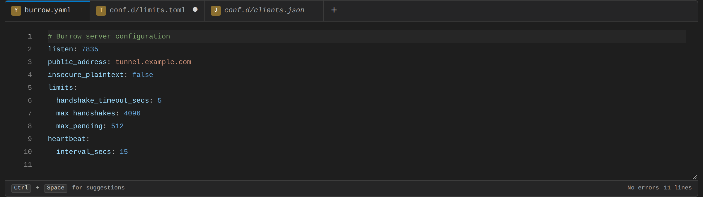

## Accessibility

### Leaving the editor with the keyboard

`Tab` indents while editing; `Ctrl+M` makes `Tab` move the focus instead (the footer says so until it is turned off), and `Escape` then `Tab` leaves once. Screen readers hear the problem at the caret and each `F8` stop.

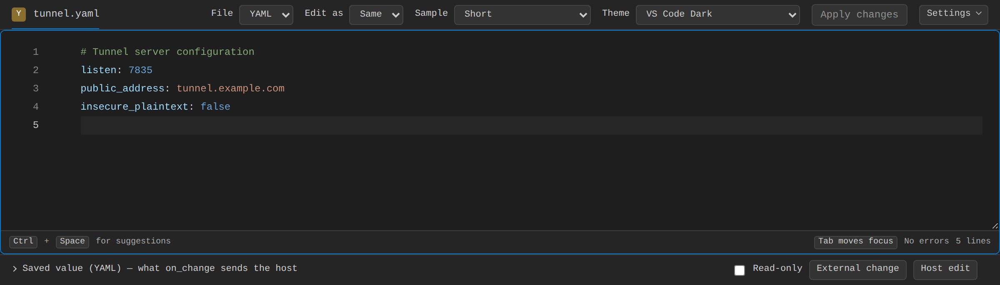

## Looks

### Themes

Eleven themes, every color a CSS variable.

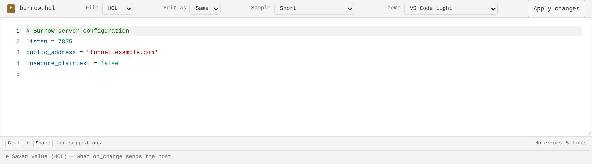

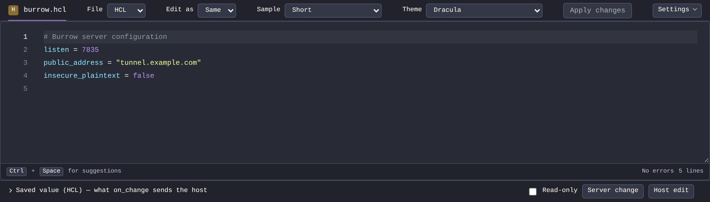

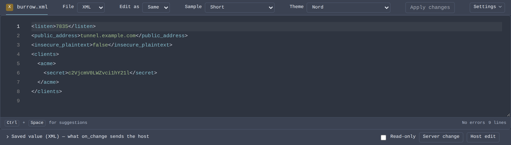

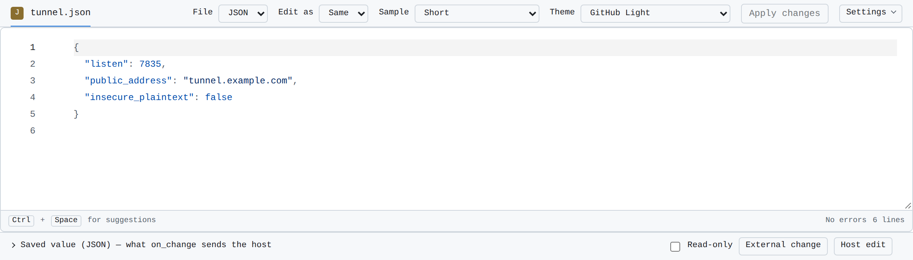

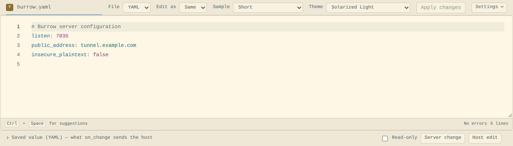

### Phones

The editor fits a phone's width; suggestions and the footer stay usable.

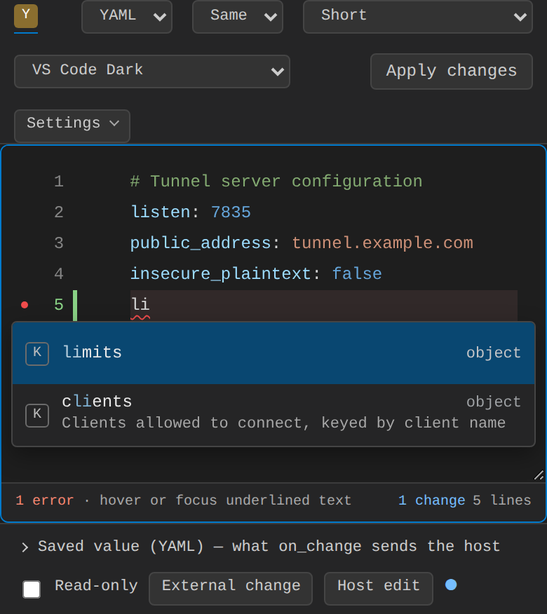
